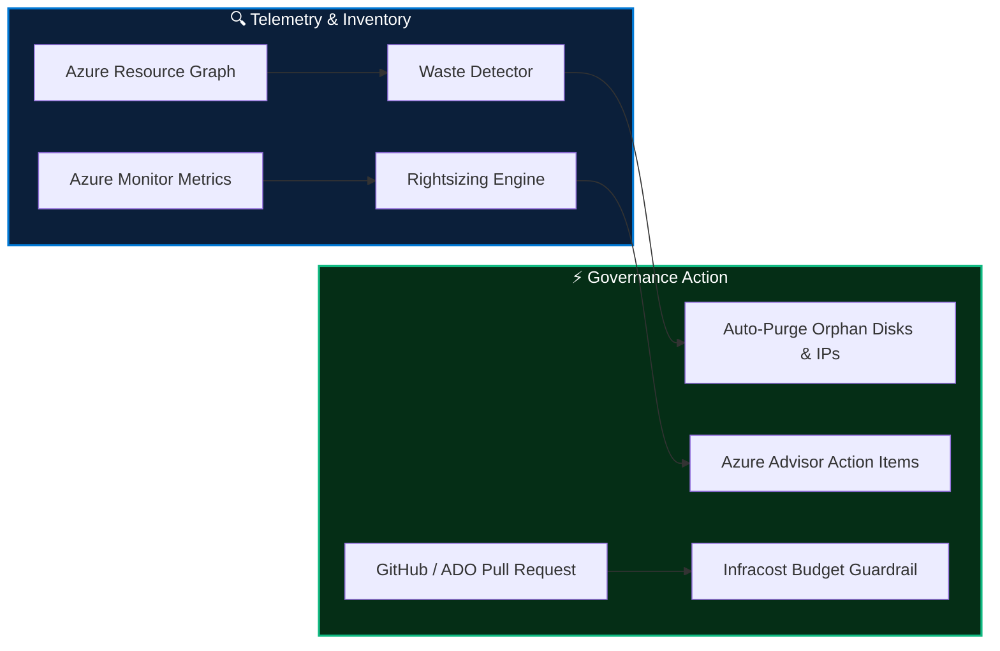

<div align="center">

# 💰 Cloud FinOps Sentinel & Cost Optimization Engine

[](#)
[](#)
[](#)
[](https://python.org)

**Automated multi-subscription cloud financial management engine delivering continuous waste elimination, right-sizing analysis, and pre-merge Infracost PR budget enforcement.**

</div>

---

## 📊 Key Highlights & Quantified Impact

- 🗑️ **Waste Detection:** Programmatic identification of orphaned managed disks, unassociated public IPs, obsolete VM snapshots (>30 days), and idle compute.
- 📉 **Right-Sizing Analytics:** Evaluates P95 CPU & RAM telemetry from Azure Monitor to generate safe compute downgrade recommendations.
- 🛑 **Non-Prod Scheduling:** Automated start/stop automation schedules slashing non-working-hour dev/test spend by **65%**.
- 🛡️ **Shift-Left Budget Guardrails:** Integration of Infracost into Azure DevOps and GitHub Actions blocking costly IaC commits before merge.
- 💵 **Total Impact:** Generated over **$400,000+ in annual recurring cloud OPEX savings** across 100+ enterprise workloads.



---

## 📁 Repository Structure

```
.
├── analyzers/
│   ├── waste_detector.py      # Unattached disks, snapshots, and public IP detection
│   └── rightsizing_engine.py  # VM right-sizing and SKU optimization logic
├── infracost/
│   └── budget-guardrail.yml   # Pre-merge pull request cost threshold policy
└── README.md
```

---

## 👤 Author

**Sujeet Kumar**  
*Senior DevSecOps Engineer & Enterprise Cloud Architect (17+ Years Experience)*  
[](https://linkedin.com/in/sujeetkumar122)
[](https://github.com/Sujeetkumar122)
